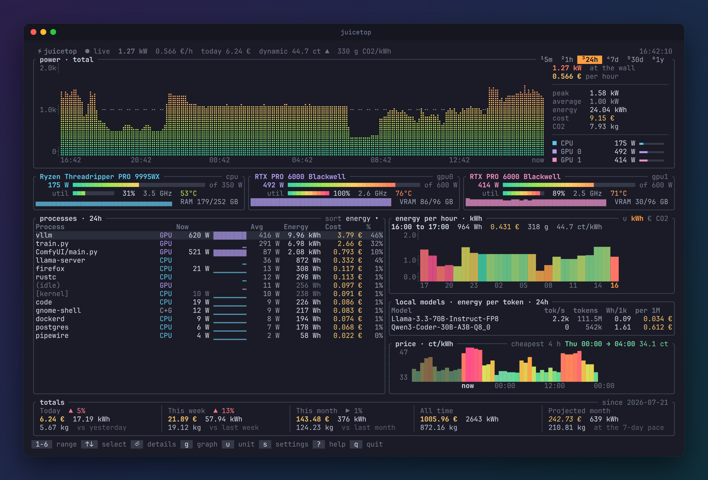
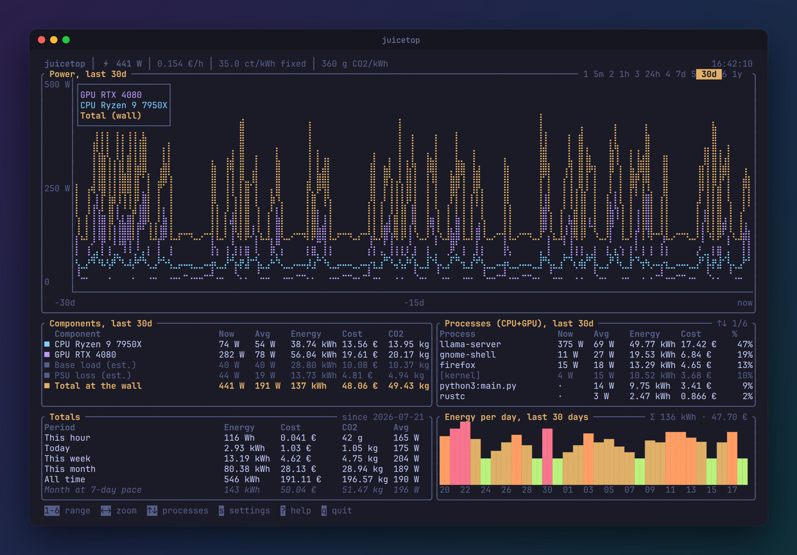
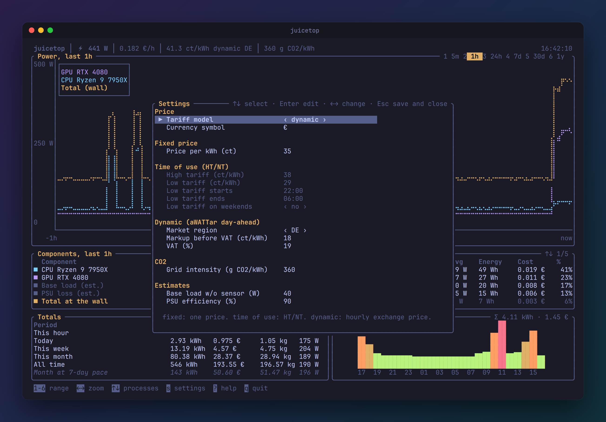

<h1 align="center">juicetop</h1>

<p align="center">
  <b>How much power does your PC really draw, and what does it cost you?</b><br>
  A btop-style terminal dashboard for your computer's electricity use, with history, cost and CO2.
</p>

<p align="center">
  <a href="https://github.com/CookedApps/juicetop/actions/workflows/ci.yml"></a>
  <a href="#license"></a>
  
</p>

<p align="center">
  
</p>

A small collector runs in the background and records every second. The dashboard shows live
watts, history by hour, day, week and month, which components and which processes used the
energy, what it cost on your tariff and how much CO2 that was.

It was built to answer "my GPU has been running a local LLM for three days, what is that costing
me?", and works just as well for gaming rigs, render boxes and homelab servers.

## Features

- **Live power** per component as braille graphs, plus the estimated total at the wall
- **History that survives restarts**: per-second data for 48 hours, per-minute data forever (SQLite)
- **Cost on your tariff**: a fixed price, a high/low tariff with a time window (HT/NT), or a
  **dynamic tariff** priced with hourly day-ahead prices (aWATTar, Germany and Austria)
- **CO2 estimate** from the intensity of your own electricity mix
- **Per-process energy**: see whether it was `llama-server`, ComfyUI or your browser
- **Totals** for this hour, today, this week, this month, all time, and a monthly projection
- **Settings inside the dashboard**: change price, tariff, CO2 factor or estimates and the whole
  history is re-priced instantly
- **Light**: one binary, the collector uses about 1.5 % of one CPU core, 25 MB of RAM and writes
  to disk once a minute

## Install

```bash
curl -fsSL https://raw.githubusercontent.com/CookedApps/juicetop/main/install.sh | sh
```

This downloads the binary for your CPU (x86_64 or aarch64), installs it to `/usr/local/bin` and
starts the collector as a sandboxed systemd service (asks for sudo once). Then open the dashboard:

```bash
juicetop
```

Nothing recorded yet? `juicetop demo` shows the dashboard with generated example data.

<details>
<summary>Other ways to install</summary>

**With cargo** (Rust 1.89 or newer):

```bash
cargo install --locked --git https://github.com/CookedApps/juicetop
sudo "$(command -v juicetop)" service install
```

**Without root.** The collector runs as your user; RAPL CPU counters are then unavailable (see
[What it measures](#what-it-measures)):

```bash
curl -fsSL https://raw.githubusercontent.com/CookedApps/juicetop/main/install.sh | JUICETOP_SERVICE=user sh
```

**Binary only**, no service: `JUICETOP_SERVICE=none`. **A specific version**: `JUICETOP_VERSION=v0.1.0`.

**Uninstall:**

```bash
sudo juicetop service uninstall           # add --purge to delete the recorded data
juicetop service uninstall --user         # if you installed the user service
```

</details>

## Usage

| Command | What it does |
|---|---|
| `juicetop` | the dashboard |
| `juicetop demo` | the dashboard with generated example data |
| `juicetop summary` | totals as plain text, handy for scripts and cron |
| `juicetop sensors` | which sensors work on this machine, with a one second reading |
| `juicetop service install` / `uninstall` / `status` | manage the background collector (`--user` for a per-user service) |
| `juicetop daemon` | run the collector in the foreground |

| Key | Action |
|---|---|
| `1` to `6` | 5 minutes, 1 hour, 24 hours, 7 days, 30 days, 1 year |
| `←` `→` | zoom out and in |
| `↑` `↓` | scroll the process list |
| `s` | settings |
| `?` | help |
| `q` | quit |

<p align="center">
  
  
</p>

## Configuration

Settings live in `~/.config/juicetop/config.toml`. The easiest way to change them is the settings
screen (`s`). They are applied when reading, so they also apply to everything recorded before.

```toml
currency = "€"

[price]
mode = "fixed"              # "fixed", "time_of_use" or "dynamic"
fixed_ct_per_kwh = 35.0     # your price per kWh incl. VAT in cents; also the fallback price

[price.time_of_use]
high_ct_per_kwh = 38.0
low_ct_per_kwh = 29.0
low_start = "22:00"         # local time; the window may cross midnight
low_end = "06:00"
low_on_weekends = false

[price.dynamic]
region = "de"               # "de" or "at"
markup_ct_per_kwh = 18.0    # grid fees, levies, taxes and margin per kWh, before VAT
vat_percent = 19.0

[co2]
g_per_kwh = 360.0           # from your supplier's fuel mix label

[estimate]
base_watts = 40.0           # everything without a sensor: mainboard, RAM, drives, fans
psu_efficiency_percent = 90.0

[data]
# db_path = "/var/lib/juicetop/juicetop.db"   # detected automatically
# live_path = "/run/juicetop/live.json"
```

**Dynamic tariffs** cost `(exchange price + markup) × (1 + VAT)` per hour. Market prices come from
the free aWATTar API and are cached in `~/.cache/juicetop/`. Totals marked `*` were partly priced
with the fixed price because market data was missing.

**CO2:** suppliers in the EU publish the CO2 intensity of their electricity in g/kWh (in Germany
on the bill as part of the "Stromkennzeichnung"). A green tariff can be far below the grid average.

## What it measures

| Part | Source | Needs |
|---|---|---|
| CPU package | RAPL energy counters (`/sys/class/powercap`) | root |
| CPU package on AMD APUs (Ryzen with integrated graphics) | amdgpu socket power (PPT), used when RAPL is unreadable | nothing |
| NVIDIA GPUs | NVML energy counter, or power readings on older cards | NVIDIA driver |
| AMD GPUs | amdgpu hwmon power | nothing |
| Mainboard, RAM, drives, fans | **estimate**: a constant base load you set (default 40 W) | |
| Power supply losses | **estimate** from the efficiency you set (default 90 %) | |

Software sensors cannot see everything, so the total at the wall is the measured parts plus two
estimates. If you own a plug-in energy meter, compare once and adjust the base load in the
settings. Monitors and other devices on the same socket are not included.

**Per-process energy is an attribution, not a measurement.** CPU energy is split by each process's
share of CPU time, GPU energy by its share of GPU utilization. While the GPU idles, its idle power
is split by the GPU memory each process holds, because that is what keeps it awake. Kernel threads
are grouped as `[kernel]`, energy nobody can be blamed for as `(idle)`.

## How it works

```
juicetop daemon ── every second ──▶ /run/juicetop/live.json        last 3 minutes, tmpfs
       │
       └──────── every minute ────▶ /var/lib/juicetop/juicetop.db  SQLite
                                           │
juicetop (dashboard) ◀─────────────────────┘ reads both, applies price, CO2 and estimates
```

The collector commits to SQLite once a minute, so your SSD sees one small write a minute. The
newest seconds reach the dashboard through the live snapshot on tmpfs. The system service runs as
root (for RAPL) inside a systemd sandbox without network access, and its files are readable by
every user, so the dashboard never needs root.

## Privacy

Everything stays on your machine. The collector has no network access. The dashboard makes one
kind of request, to aWATTar for market prices, and only if you choose the dynamic tariff.

## Status

juicetop is young. This is what has and has not been checked so far.

**Tested on real hardware:** AMD Ryzen 9 7950X with NVIDIA GeForce RTX 4080 on Zorin OS 18
(Ubuntu 24.04 base), collector running as a user (CPU via socket power, GPU via NVML), dashboard,
`summary`, `sensors`, and dynamic prices against the live aWATTar API.

**Covered by automated tests only, never run on real hardware:**

- RAPL on Intel CPUs and RAPL as root on AMD (the parser is tested with fake sysfs trees)
- AMD discrete GPUs, more than one GPU, multi-socket machines
- NVIDIA cards without an energy counter (pre-Volta), which use the power fallback

**Not tested yet:**

- The system service end to end (`sudo juicetop service install`) and its sandbox settings
- `install.sh` and the release workflow (no release has been published yet)
- aarch64 builds, distributions other than Ubuntu derivatives, non-systemd systems
- The Austrian aWATTar region, daylight saving time changes, months or years of real data
- How close the estimated total is to a wall meter

## Roadmap

Ideas and open features, roughly by priority. Help is welcome on any of them.

- [ ] Smart plugs (Shelly, Tasmota) as a source for real power at the wall, and a calibration
      helper that sets the base load from them
- [ ] Intel GPUs (i915 / xe energy counters) and laptop battery discharge as a source
- [ ] Live grid CO2 intensity (Energy-Charts, Electricity Maps) as an alternative to a fixed value
- [ ] More dynamic tariff sources (Tibber, Octopus Agile, other ENTSO-E markets)
- [ ] Export: CSV and JSON from `juicetop summary`, a Prometheus endpoint
- [ ] History per process: a graph for one selected process
- [ ] Configurable retention and database maintenance (vacuum, size display)
- [ ] Packages: crates.io, AUR, .deb, Nix
- [ ] macOS (powermetrics) and Windows support

## Contributing

Bug reports with the output of `juicetop sensors` are the most useful contribution right now,
especially from hardware listed under "not tested". See [CONTRIBUTING.md](CONTRIBUTING.md) for
setup, tests and commit conventions, and [AGENTS.md](AGENTS.md) for a map of the code.

## License

Licensed under either of [Apache License 2.0](LICENSE-APACHE) or [MIT](LICENSE-MIT), at your option.
Unless you explicitly state otherwise, any contribution you submit for inclusion in this project
shall be dual licensed as above, without any additional terms or conditions.
