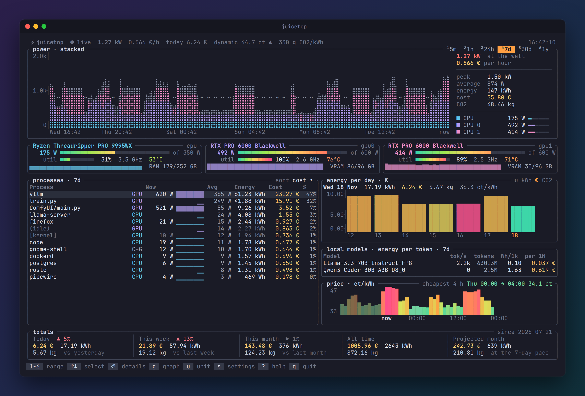
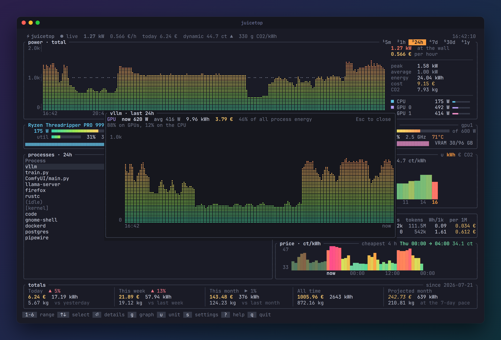

<h1 align="center">juicetop</h1>

<p align="center">
  <b>What does your computer cost to run?</b><br>
  A btop-style terminal dashboard for the power, money and CO2 your computer uses.
</p>

<p align="center">
  <a href="https://github.com/CookedApps/juicetop/actions/workflows/ci.yml"></a>
  <a href="https://github.com/CookedApps/juicetop/releases/latest"></a>
  <a href="#license"></a>
  
</p>

<p align="center">
  
</p>

juicetop measures CPU and GPU power every second, keeps the history and prices it with your
tariff. You see which programs used the energy, what a local model server pays per million
tokens, and which hours tomorrow cost the least.

## Features

- Live power per CPU and GPU, with utilization, temperature, clock and memory
- History per second for two days and per minute for good, in SQLite
- Cost with a fixed price, a day/night tariff or hourly exchange prices (Germany, Austria)
- CO2 from your country's grid or from your own tariff's mix
- Energy and cost per process, split into CPU and GPU
- Energy per token for local model servers: llama.cpp, vLLM, SGLang and Text Generation Inference
- The cheapest upcoming hours, for jobs you can schedule
- A four-step setup on first start; changed settings apply to the whole history
- Themes from popular editors: Tokyo Night, Catppuccin, Dracula, Nord, Gruvbox, One Dark,
  Monokai, Solarized and GitHub Light, plus muted, greyscale and your terminal's own colors.
  Pick one under `s` → Theme
- One binary. The collector uses about 1.5 % of one core and writes to disk once a minute

## Install

Linux and macOS (Apple Silicon):

```bash
curl -fsSL https://raw.githubusercontent.com/CookedApps/juicetop/main/install.sh | sh
```

Windows, in PowerShell:

```powershell
irm https://raw.githubusercontent.com/CookedApps/juicetop/main/install.ps1 | iex
```

Then run `juicetop`. The first start walks you through the setup, and `juicetop demo` shows
generated data while yours comes in. Run the install command again to update.

<details>
<summary>What the script does, other ways to install, and how to remove it</summary>

**The script** downloads the binary for your system and starts the collector in the background:
a systemd service on Linux, a launchd daemon on macOS (both ask for sudo once), a Task Scheduler
task on Windows (from boot in an administrator terminal, from logon otherwise). An update keeps
your settings, your data and the kind of collector you picked.

**With cargo** (Rust 1.89 or newer):

```bash
cargo install --locked --git https://github.com/CookedApps/juicetop
sudo "$(command -v juicetop)" service install
```

**Without root** (Linux). The collector runs as your user. You lose the RAPL CPU counters; see
[What it measures](#what-it-measures). macOS has no user collector, because only root gets
power readings there.

```bash
curl -fsSL https://raw.githubusercontent.com/CookedApps/juicetop/main/install.sh | JUICETOP_SERVICE=user sh
```

`JUICETOP_SERVICE=none` installs the binary without a service. `JUICETOP_VERSION=v0.1.0` picks a
release.

**Remove:**

```bash
sudo juicetop service uninstall        # --purge deletes the recorded data too
juicetop service uninstall --user      # for the user service
```

On Windows run `juicetop service uninstall` from an administrator terminal, or with `--user`
for the logon task, then delete `%LOCALAPPDATA%\Programs\juicetop`.

</details>

## Setup

Four steps, each with a default. Pressing Enter four times gives you sensible values.

1. **Country.** Sets the currency, a typical price and the grid's CO2 intensity. juicetop guesses
   it from your time zone.
2. **Tariff.** Fixed, day/night or dynamic, with the price prefilled.
3. **Mix.** Your country's grid average, a green tariff, or the value from your bill.
4. **Computer.** The draw of everything without a sensor, and the power supply's efficiency.

Run it again with `juicetop setup` or `S` in the dashboard. `s` opens all settings.

## Use

| Command | What it does |
|---|---|
| `juicetop` | the dashboard |
| `juicetop demo` | the dashboard with generated data |
| `juicetop setup` | the setup |
| `juicetop summary` | totals as plain text, for scripts and cron |
| `juicetop sensors` | the sensors this machine has, with a one second reading |
| `juicetop service install` / `uninstall` / `status` | the background collector (`--user` for a user service) |
| `juicetop daemon` | the collector in the foreground |

| Key | Action |
|---|---|
| `1` to `6` | 5 minutes, 1 hour, 24 hours, 7 days, 30 days, 1 year |
| `←` `→` | zoom out and in |
| `↑` `↓`, `Enter` | select a process, open its history |
| `e` `n` `c` | sort processes by energy, current draw or cost |
| `g` | total or stacked power graph |
| `u`, `[` `]` | bars in kWh, money or CO2; select a bar |
| `s`, `S` | settings, setup |
| `?`, `q` | help, quit |

The mouse works for the range tabs, processes and bars.

<p align="center">
  
  
</p>

## Energy per token

The collector looks for model servers on your machine and reads their Prometheus counters every
five seconds. The dashboard divides the energy of the serving process by the tokens it generated.
Idle time with the model loaded counts, because serving costs it.

| Server | Counter | Needs |
|---|---|---|
| llama.cpp (`llama-server`) | `llamacpp:tokens_predicted_total` | `--metrics` |
| vLLM | `vllm:generation_tokens_total` | |
| SGLang | `sglang:generation_tokens_total` | `--enable-metrics` |
| Text Generation Inference | `tgi_request_generated_tokens_sum` | |
| Strata | `vllm:generation_tokens_total` | |

Discovery checks processes with these names and talks to them on 127.0.0.1, on the server's own
port. Servers behind a proxy such as llama-swap work the same way. The energy of a server counts
its child processes, where some servers run the model. Ollama has no token
counters yet, so juicetop cannot see it. For a server with another name, pass its metrics URL:

```bash
sudo systemctl edit juicetop
```

```ini
[Service]
ExecStart=
ExecStart=/usr/local/bin/juicetop daemon --model-endpoint http://127.0.0.1:9000/metrics
```

The service may reach localhost and nothing else. For a server on another machine, add
`IPAddressAllow=` with its address in the same file.

## Prices

| Tariff | Price per kWh |
|---|---|
| Fixed | one price |
| Day/night | a day and a night price with the hours of the night tariff |
| Dynamic | the hourly exchange price from [aWATTar](https://www.awattar.de) plus your supplier's markup and VAT |

juicetop prices every 15 minutes with the tariff of that moment, so day/night and dynamic totals
come out exact. With a day/night or dynamic tariff, the price panel shows the next hours and the
cheapest window of `cheapest_window_hours` (default 4).

## Configuration

The setup and the settings screen write `~/.config/juicetop/config.toml`. You can edit it by hand:

```toml
country = "DE"
currency = "€"
theme = "juicetop"

[price]
mode = "fixed"              # "fixed", "time_of_use" or "dynamic"
fixed_ct_per_kwh = 36.0     # price per kWh incl. VAT in cents (pence, öre...); also the fallback
cheapest_window_hours = 4

[price.time_of_use]
high_ct_per_kwh = 39.0
low_ct_per_kwh = 29.0
low_start = "22:00"         # local time; may cross midnight
low_end = "06:00"
low_on_weekends = false

[price.dynamic]
region = "de"               # "de" or "at"
markup_ct_per_kwh = 20.0    # grid fees, levies, taxes and margin per kWh, before VAT
vat_percent = 19.0

[co2]
g_per_kwh = 330.0

[estimate]
base_watts = 40.0           # mainboard, RAM, drives, fans
psu_efficiency_percent = 90.0
```

A total marked `*` used the fixed price for hours without market data.

## What it measures

| Part | Source | Needs |
|---|---|---|
| CPU package (Linux) | RAPL energy counters (`/sys/class/powercap`) | root |
| CPU package on AMD APUs (Linux, Ryzen with integrated graphics) | amdgpu socket power, when RAPL is unreadable | nothing |
| NVIDIA GPUs (Linux, Windows) | NVML energy counter, or power readings on older cards | NVIDIA driver |
| AMD GPUs (Linux) | amdgpu hwmon power | nothing |
| CPU, GPU and Neural Engine (macOS, Apple Silicon) | `powermetrics` energy per sample | root |
| CPU package (Windows; untested) | the `Energy Meter` performance counters | Windows 11 and a CPU that reports them |
| Mainboard, RAM, drives, fans | your estimate (default 40 W) | |
| Power supply loss | your efficiency estimate (default 90 %) | |

Intel Macs and Windows machines without an energy meter get no CPU sensor; the base load estimate
covers them. On a Mac the Neural Engine counts toward the GPU.

Software sensors miss part of the system, so the total at the wall adds two estimates to what
juicetop measures. If you own a plug-in energy meter, compare the two once and adjust the base
load. Monitors and other devices on the same socket do not count.

Per-process numbers come from attribution. juicetop splits CPU energy by each process's CPU time
and GPU energy by GPU utilization. An idle GPU's power goes to the processes holding its memory.
Kernel threads appear as `[kernel]`, energy without a process as `(idle)`.

## How it works

```
juicetop daemon ── every second ──▶ /run/juicetop/live.json        last 3 minutes, tmpfs
       │
       └──────── every minute ────▶ /var/lib/juicetop/juicetop.db  SQLite
                                           │
juicetop (dashboard) ◀─────────────────────┘ reads both, applies price, CO2 and estimates
```

The collector runs as root for RAPL, inside a systemd sandbox that allows writes to its two paths
and network access to localhost. Every user can read its files, so the dashboard needs no root.

On macOS the files live in `/Library/Application Support/juicetop` and `/var/run/juicetop`, on
Windows in `%ProgramData%\juicetop` (or in your own profile for a user collector). Without `/proc`,
juicetop reads processes through the operating system's own interface and finds model servers by
their `--port` flag or default port.

## Privacy

The collector reads local sensors and the process list, and talks to model servers on 127.0.0.1. The
dashboard asks aWATTar for prices if you pick the dynamic tariff. Nothing else leaves your machine.

## Status

juicetop is young. This list shows what has been checked so far.

**On real hardware:** an AMD Ryzen 9 desktop with an NVIDIA RTX 40-series GPU on an Ubuntu 24.04
based distribution. Collector as a system service (RAPL) and as a user (socket power), the
release binaries for x86_64, the dashboard, `summary`, `sensors` and dynamic prices from aWATTar.
An Apple M2 Pro Mac: `install.sh`, the launchd service, CPU and GPU power from `powermetrics`
and the dashboard.

**In automated tests only:** RAPL on Intel CPUs, AMD GPUs, several GPUs, multi-socket machines,
NVIDIA cards without an energy counter, model server discovery and metrics parsing, the setup.

**Not tested yet:**

- Windows as a whole. The code builds and its unit tests run in CI, but nobody has run the
  collector, the Task Scheduler task or `install.ps1` on a real machine
- the Windows `Energy Meter` readings and their unit
- `install.sh` from start to finish
- the aarch64 binary on real hardware, distributions outside the Ubuntu family, systems without systemd
- energy per token against a running model server
- the Austrian price region, daylight saving time changes, histories of months
- how close the estimated total gets to a wall meter

## Roadmap

Open features, roughly by priority. Pull requests are welcome.

- [ ] Smart plugs (Shelly, Tasmota) as a source for power at the wall, and a calibration helper
- [ ] Token counts from Ollama through its API
- [ ] Intel GPUs (i915 and xe energy counters) and laptop battery discharge
- [ ] Live grid CO2 intensity (Energy-Charts, Electricity Maps)
- [ ] More dynamic tariffs (Tibber, Octopus Agile, other ENTSO-E markets)
- [ ] CSV and JSON export, a Prometheus endpoint
- [ ] Retention settings and database maintenance
- [ ] Packages for crates.io, AUR, Debian and Nix
- [ ] Windows on real machines, Intel Macs, AMD and Intel GPUs on Windows

## Contributing

Bug reports with the output of `juicetop sensors` help most, above all from hardware in the
"not tested yet" list. [CONTRIBUTING.md](CONTRIBUTING.md) covers setup, tests and commit style;
[AGENTS.md](AGENTS.md) maps the code.

## License

Licensed under either of [Apache License 2.0](LICENSE-APACHE) or [MIT](LICENSE-MIT), at your
option. Unless you state otherwise, any contribution you submit for inclusion in this project
shall be dual licensed as above, without any additional terms or conditions.
